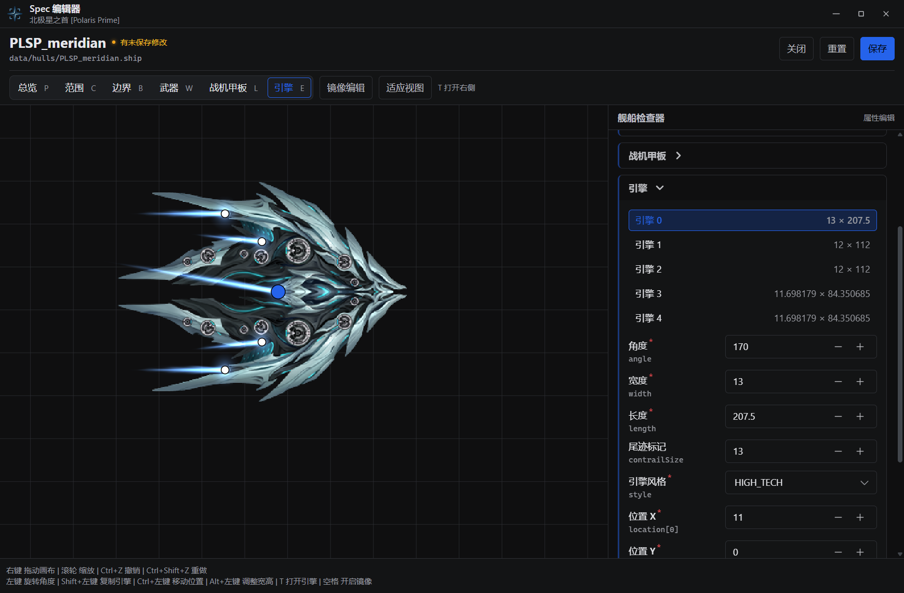
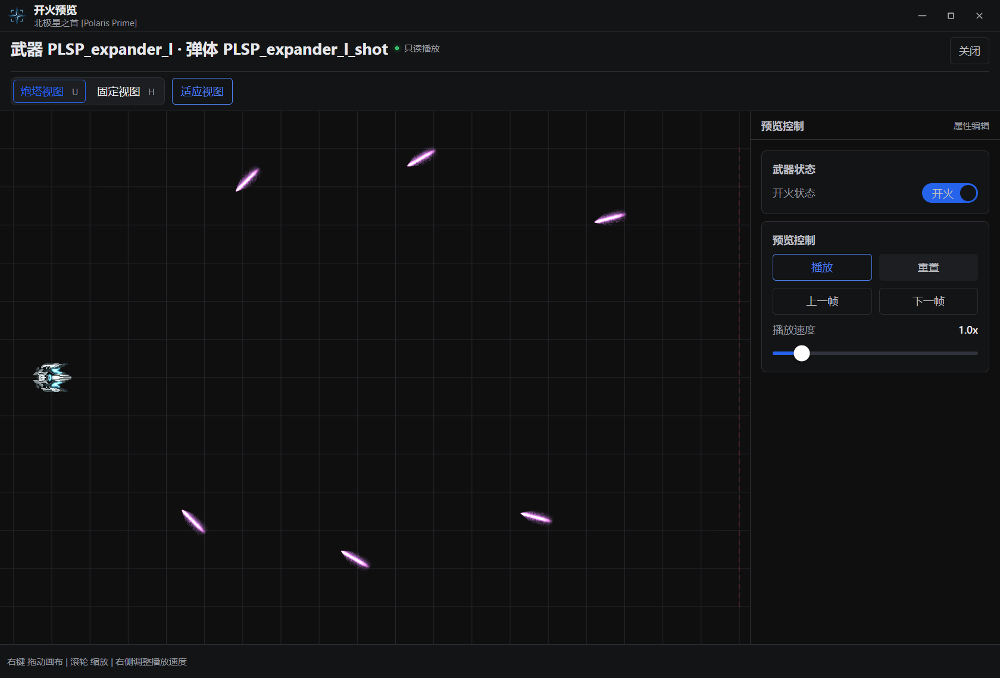
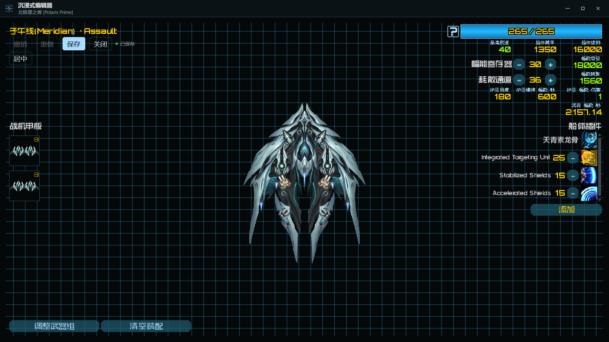
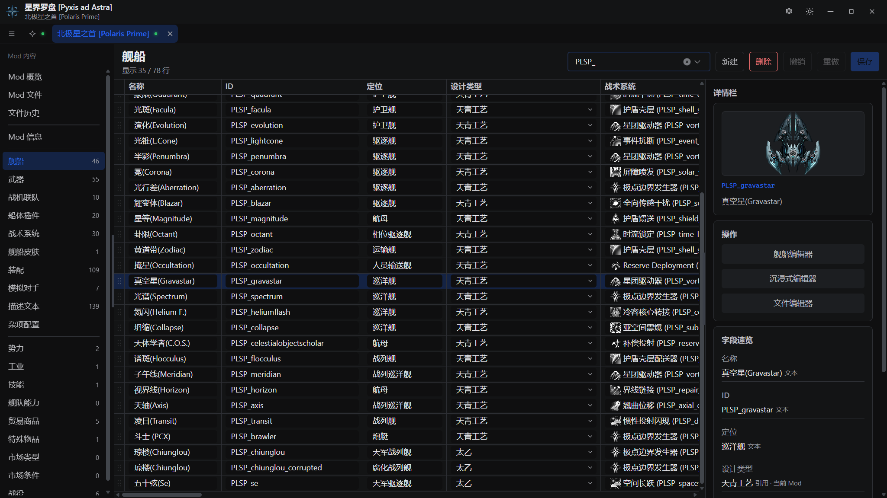
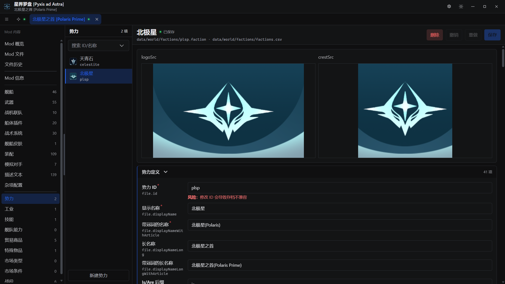
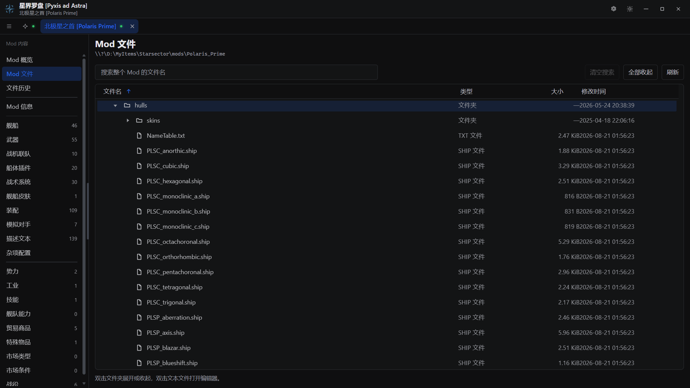

<p align="center">
  
</p>

<h1 align="center">星界罗盘 [Pyxis ad Astra]</h1>

<p align="center">
  面向 Starsector Mod 作者的 Windows 桌面配置工具。<br />
  从舰船与武器，到装配、表格与势力配置，在可视界面中完成编辑。
</p>

<p align="center">
  <a href="https://delapsa-lanterna.github.io/Pyxis-ad-Astra/">在线体验</a>
  &nbsp; · &nbsp;
  <a href="#开始使用">使用说明</a>
</p>



在舰船信息中查看外观、战斗与后勤参数，结合可视画布编辑槽位、引擎与护盾。

## 创作工作台

### 武器与开火

编辑武器与弹体规格，在开火预览中观察射击、弹道与尾迹效果。



### 装配与装备

围绕舰船配置武器、战机联队与船体插件，查看装配点数、幅能和武器分组。



### 表格与数据

在表格中编辑舰船、武器等数据，通过名称、引用与贴图辨认条目，衔接对应的专用编辑器。



### 势力与配置

通过字段表单编辑势力名称、旗帜、舰队与装备配置；同一工作区也提供 Mod 信息、战役、皮肤等配置入口。



### 文件与工作区

按目录浏览 Mod 文件，搜索并打开文本；通过顶部页签切换多个 Mod，沿用各自的编辑内容与保存历史。



## 开始使用

1. 从 [Releases](https://github.com/Delapsa-Lanterna/Pyxis-ad-Astra/releases) 下载 Windows 可执行文件并运行。
2. 在总览页打开 Starsector 游戏目录，选择要编辑的 Mod；也可以直接打开 Mod 根目录。
3. 从左侧导航进入舰船、武器、装配、表格或配置页面，选择具体条目开始编辑。
4. 保存当前编辑内容，使用撤销、重做与文件历史管理修改。

使用原版资源与引用时，配置本机 Starsector 游戏目录。资源查询优先使用当前 Mod，并从原版补全。

当前版本为 `0.1.0`。编辑前请备份 Mod；反馈问题时附上操作步骤、版本与报错信息。

[在线体验](https://delapsa-lanterna.github.io/Pyxis-ad-Astra/) 提供固定样本，编辑结果保留在当前页面会话中，刷新后恢复样本。

## 从源码运行

开发环境：Windows、Node.js `^22.13.0 || >=24.0.0` (含 npm)、Rust `1.99.1` 与 MSVC C++ 构建工具。
Rust 版本由 [rust-toolchain.toml](rust-toolchain.toml) 固定，依赖与命令见 [package.json](package.json)。

安装依赖并启动桌面开发模式：

```powershell
npm install
npm.cmd run tauri -- dev
```

构建 Windows 可执行文件：

```powershell
npm.cmd run tauri -- build --no-bundle
```

构建包含前端类型检查与生产资源打包，生成文件位于：

```text
src-tauri\target\release\pyxis-ad-astra.exe
```

项目基于 Tauri 2、Vue 3、TypeScript、Rust、Pinia、Naive UI 与 Canvas 2D 构建。
开发流程与验证命令见 [贡献指南](CONTRIBUTING.md)。

## 交流与贡献

欢迎通过 [Issues](https://github.com/Delapsa-Lanterna/Pyxis-ad-Astra/issues) 反馈问题或提出想法，也欢迎提交 Pull Request。
参与开发请阅读 [贡献指南](CONTRIBUTING.md)；版本信息见 [更新日志](CHANGELOG.md)。

## 许可

项目采用 [GPL-3.0](LICENSE) 许可。
